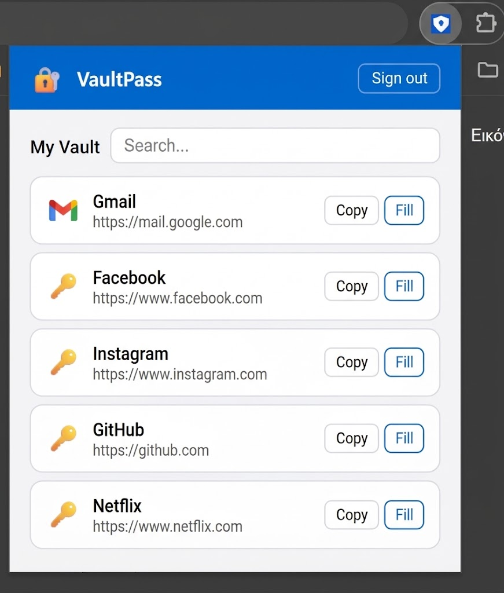

# VaultPass

## Downloads

| Platform | Link |
|----------|------|
| macOS | [VaultPass.app](https://github.com/karterisg/PasswordManager/releases/download/v1.1/VaultPass-macOS.zip) |
| Windows | _coming soon_ |
| Android | _coming soon_ |

---

VaultPass is a local-first password manager I built from scratch. The core idea is that your credentials never leave devices you control in plaintext, and you are never dependent on a third-party cloud. Depending on how you run it, the app works completely offline on your phone, through a web interface backed by your own server, or as a Chrome extension that autofills credentials on any site.

There are two distinct usage modes:

- **Standalone (MAUI)** — the Android, iOS, Windows, and macOS app stores everything locally in a SQLite database. It is fully offline and has no dependency on the API or any server. Authentication is PIN-based with optional biometrics.
- **Connected (Web + Extension)** — the Blazor web app and Chrome extension both talk to the VaultPass API. You need to be running the API (locally or self-hosted via Docker) for these clients to function. Vault items are encrypted client-side before being sent to the server.

## How it's built

### The backend: Clean Architecture

Before writing a single endpoint, I structured the backend around Clean Architecture with four projects that each have a strict dependency direction.

**VaultPass.Domain** is the innermost layer with zero external dependencies. It defines the entities (User, Vault, VaultItem, Team), domain exceptions, and enums. Every entity uses a private constructor and factory methods like `User.Create(...)` and `VaultItem.Create(...)` so you cannot construct an invalid object at the type level.

**VaultPass.Application** defines the use cases using MediatR CQRS — every operation is a Command or a Query with a dedicated handler. This layer owns the repository interfaces, so it never touches Entity Framework directly. Three pipeline behaviors run on every handler: FluentValidation for input validation, Serilog for structured logging, and a caching layer.

**VaultPass.Infrastructure** implements what the application layer declared: the EF Core DbContext, repository implementations, JWT service, and migrations. SQL Server is the default database for server deployments.

**VaultPass.API** is the ASP.NET Core host. It wires together the DI container, JWT Bearer auth, CORS policies, and runs as a Windows background service via `UseWindowsService()`. It also ships a `/api/itemtemplates` endpoint that returns the built-in item type definitions (Password, Credit Card, SSH Key, 2FA/TOTP, and more) that all clients use to render the correct fields.

### The API

The API exposes two main groups: `/api/auth` for registration and login, and `/api/vaultitems` for CRUD operations on vault entries. Login takes an email and a SHA-256 hash of the master password — the raw password never travels over the wire. On success it returns a JWT that all clients attach to subsequent requests. The JWT payload includes the user's vault ID, which the clients use client-side to scope encryption.

On Windows the API is published as a self-contained executable and registered in Task Scheduler to start automatically at login. It listens on `http://localhost:5243`.

### The Web App: Blazor WebAssembly

`VaultPass.Web` is a Blazor WASM app that runs entirely in the browser after the initial load. It talks to the API over HTTP, stores the JWT in localStorage, and handles the full auth and vault management flow including the item template picker.

The modal display issue that Blazor WASM had on Bootstrap-hosted pages is worth noting: Bootstrap ships a global `.modal { display: none }` rule that overrides any custom modal CSS. The fix was to add `display: block !important` to the app stylesheet so the Bootstrap rule cannot win regardless of load order.

To run locally: `dotnet run --project src/VaultPass.Web` — comes up on `http://localhost:5002`. No npm, no bundler.

### The Mobile App: MAUI Blazor Hybrid (offline-first)

`VaultPass.MAUI` is a .NET MAUI app that hosts Blazor components in a native WebView. Unlike the web app, the mobile app is fully offline. It does not talk to the API at all — everything is stored locally on the device in a SQLite database using `sqlite-net-pcl`.

**Authentication** is PIN-based. On first launch the user sets a 4-digit PIN, which is SHA-256 hashed and stored in the OS secure storage. A random 32-byte salt is generated per device and stored alongside the hash so that the same PIN on two devices produces different hashes.

**Biometrics** integrate with the OS fingerprint / Face ID stack via `Plugin.Fingerprint`. On first successful PIN entry the user is offered the option to enable biometric unlock for future sessions. The biometric preference is stored in SecureStorage. On iOS and Android the prompt appears automatically if biometrics are configured.

**Recovery codes** handle the case where a user forgets their PIN. During setup, a 24-character recovery code is generated (grouped as `XXXXX-XXXXX-XXXXX-XXXXX`) and its SHA-256 hash is stored in SecureStorage. The code is shown once and never again. On the PIN screen, tapping the logo five times reveals a hidden link to the recovery flow. The recovery flow accepts the code, verifies it against the hash, and lets the user set a new PIN without losing vault data.

**Item templates** are defined entirely in the app code as a `BuiltInTemplates` collection — no network call needed. Each template defines the fields to show (URL, username, password, TOTP secret, card number, expiry, etc.) and a display name. When an item is saved, the template name is stored as a string in the SQLite row so that it survives database upgrades without foreign key dependencies.

The BlazorWebView URL caching problem on Windows desktop was the trickiest part of the MAUI work. When the app restarts, the WebView restores its last URL before any C# code runs. If the last page was `/pin-login`, the Router renders that component from the cached URL even when no PIN is set yet. The fix was to abandon URL-based navigation entirely in the root `Routes.razor` and instead render `<PinSetup />`, `<PinLogin />`, or the main `<Router>` directly based on state flags read during `OnInitializedAsync`.

A related issue: `SecureStorage.Default.RemoveAll()` on Windows does not reliably delete the `.dat` file that backs secure storage. On a clean install the stale file from a previous installation would make the app think a PIN was already set. The fix was a versioned file marker (`install_v4.marker`) written to the app data directory on first run. If the marker is missing, the code directly deletes the SecureStorage `.dat` file before doing anything else.

### The Chrome Extension



The extension is Manifest V3 and has three parts: a background service worker, a content script, and a popup.

**The background service worker** (`background.js`) handles all API calls and keeps the session JWT in `chrome.storage.local`. The popup and content script communicate with it via `chrome.runtime.sendMessage` using typed messages (`LOGIN`, `GET_ITEMS`, `GET_MATCHING`, `SAVE_ITEM`).

**Encryption** uses the Web Crypto API with AES-256-GCM. The key is derived client-side from the password hash and vault ID — two values the server never has together — so the API stores only ciphertext it cannot decrypt.

**The content script** runs on every page, checks for matching credentials by `window.location.origin`, and injects an autofill banner when a match is found. It handles both the current joint-encrypted format (username + password encrypted together as JSON) and older entries that stored the password as a plain string.

**The popup** shows a login form or the vault list depending on whether a token exists. Each item has a Fill button. You can also save new credentials for the current site directly from the popup.

## Running everything

### Docker (self-hosted Linux / VPS)

The cleanest way to run VaultPass on a server is with Docker Compose. The `docker-compose.yml` brings up the API and a SQL Server instance together.

Copy the example env file and fill in your values:

```bash
cp .env.example .env
```

The three required values:

```
SA_PASSWORD=a_strong_sql_password
JWT_SECRET=at_least_32_characters_change_this
ASPNETCORE_ENVIRONMENT=Production
```

Then start everything:

```bash
docker compose up -d
```

The API comes up on port `5243`. Vault data is persisted in a named volume (`sqlserver_data`) that survives restarts and image rebuilds. To update:

```bash
git pull
docker compose up -d --build
```

The `Dockerfile` produces a self-contained .NET 10 image with no credentials baked in — the connection string and JWT secret are injected at runtime from the environment. If you also want the web app publicly accessible, point it at the server's public address and put both services behind an Nginx or Caddy reverse proxy.

### Windows

The API runs as a Task Scheduler entry named `VaultPassAPI` that starts automatically at user login. First publish it as a self-contained executable:

```powershell
dotnet publish src/VaultPass.API/VaultPass.API.csproj -c Release -r win-x64 --self-contained -o publish/VaultPass.API
```

Then register the Task Scheduler entry (run PowerShell as Administrator):

```powershell
$action = New-ScheduledTaskAction -Execute "D:\desktop\VaultPass\publish\VaultPass.API\VaultPass.API.exe"
$trigger = New-ScheduledTaskTrigger -AtLogOn
$settings = New-ScheduledTaskSettingsSet -ExecutionTimeLimit 0
Register-ScheduledTask -TaskName "VaultPassAPI" -Action $action -Trigger $trigger -Settings $settings -RunLevel Highest
```

The API will start automatically on every login and run in the background. To start it immediately without logging out:

```powershell
Start-ScheduledTask -TaskName "VaultPassAPI"
```

The API listens on `http://localhost:5243`. Place the `appsettings.json` next to the executable with your connection string and JWT secret — never commit this file.

For the web app: `dotnet run --project src/VaultPass.Web` → `http://localhost:5002`.

For development with the Scalar API explorer: `dotnet run --project src/VaultPass.API` → `https://localhost:7012/scalar/v1`.

The Chrome extension loads unpacked from `src/VaultPass.Extension` via `chrome://extensions` with Developer Mode on.

The MAUI Windows desktop app publishes to a self-contained EXE: `dotnet publish src/VaultPass.MAUI/VaultPass.MAUI.csproj -f net10.0-windows10.0.19041.0 -c Release`.

### Android

Build and sign the APK:

```bash
dotnet publish src/VaultPass.MAUI/VaultPass.MAUI.csproj -f net10.0-android -c Release
```

The signed APK ends up in `bin/Release/net10.0-android/publish/`. Install with `adb install` or side-load directly. The mobile app is fully offline so no API setup is needed on the device.

### iOS / macOS

Both targets require a Mac with Xcode and an Apple Developer account. Clone the repo on a Mac and run:

```bash
# macOS
dotnet publish src/VaultPass.MAUI/VaultPass.MAUI.csproj -f net10.0-maccatalyst -c Release

# iOS
dotnet publish src/VaultPass.MAUI/VaultPass.MAUI.csproj -f net10.0-ios -c Release
```

These builds cannot be produced on Windows — the iOS and macOS SDKs ship only with Xcode.

## Security model

**Web and extension clients:** The master password is hashed with SHA-256 before it leaves the device. The API stores only that hash, re-hashed internally. Vault items are encrypted client-side with AES-256-GCM before being sent to the API. The encryption key is derived from the password hash and vault ID — two values never stored together anywhere — so a stolen database is useless without the master password.

**MAUI (offline):** There is no master password in the traditional sense. A 4-digit PIN unlocks the device's local vault. The PIN hash is salted per device so it cannot be brute-forced across devices. The SQLite database on disk is not separately encrypted at this point — the security boundary is the device's own storage encryption (Android's FBE, iOS data protection, Windows DPAPI). For a threat model that assumes physical device access, the next step would be SQLCipher.

**Recovery codes:** The 24-character recovery code is the only way to reset the PIN without losing vault access. It is hashed with SHA-256 and the hash is the only thing stored. The raw code is shown once during setup and never retrievable again.

**JWT secret:** In production deployments the secret must come from an environment variable, not a config file. The `appsettings.json` in this repo is gitignored; the `.env.example` shows the expected variable name.
